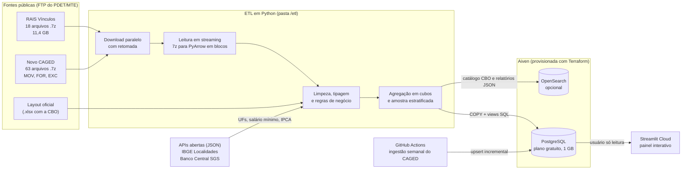
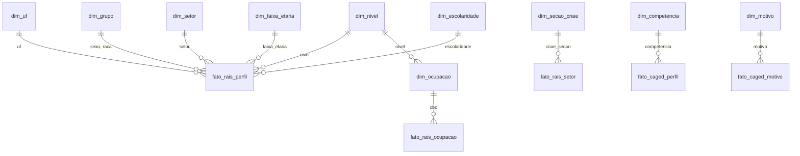

# Gap salarial e funil de liderança corporativa

Pipeline de dados e painel interativo que medem a diferença salarial e a presença de mulheres e pessoas negras em cada nível hierárquico do emprego formal brasileiro. Os dados são os microdados públicos da RAIS (2023 a 2025) e do Novo CAGED (janeiro de 2025 a setembro de 2026), publicados pelo Programa de Disseminação das Estatísticas do Trabalho (PDET) do Ministério do Trabalho e Emprego.

O projeto foi feito para a disciplina Big Data e Analytics e se alinha às ODS 5 (igualdade de gênero) e 18 (igualdade étnico-racial).

**Painel publicado:** [gap-salarial-lideranca-ck839dzqbixnkrlm4k5mkc.streamlit.app](https://gap-salarial-lideranca-ck839dzqbixnkrlm4k5mkc.streamlit.app)

## Perguntas que o projeto responde

1. Quanto mulheres e pessoas negras ganham a menos por hora trabalhada, e quanto dessa diferença continua quando se compara gente com a mesma escolaridade, idade, UF, nível hierárquico e setor?
2. Em que ponto do funil (base, supervisão, gerência, direção) cada grupo perde presença?
3. Na entrada e na saída de cargos de liderança, o padrão se repete? Mulheres são contratadas com salário menor? Saem mais?

Todas as métricas cruzam sexo e raça/cor. O grupo de referência dos gaps é o de homens brancos.

## Principais resultados (2025, setor privado)

Mulheres recebem, em média, 17,5% a menos por hora que homens. Quando a comparação é feita dentro de células com a mesma UF, faixa etária, escolaridade, nível hierárquico, setor e raça/cor, o gap sobe para 25,3%. A diferença bruta é menor porque as mulheres empregadas têm, em média, mais escolaridade que os homens.

Mulheres negras recebem 45,3% a menos por hora que homens brancos (36,3% no gap controlado). Esse gap era de 45,0% em 2023.

O funil se estreita para pessoas negras de forma muito mais forte do que para mulheres. Pessoas negras são 53,4% dos vínculos na base e 23,6% na direção. Mulheres negras passam de 20,9% da base para 9,9% da direção; homens brancos, de 24,4% para 44,4%. Na direção, o salário-hora médio de homens brancos é R$ 242,40 e o de mulheres negras, R$ 81,90.

No fluxo de 2025 (Novo CAGED, emprego celetista), mulheres contratadas para gerência e direção tiveram salário médio de admissão de R$ 5.968, 24,9% abaixo dos R$ 7.947 dos homens. A rotatividade delas nesses cargos foi de 25,2%, contra 23,1% dos homens.

No setor público o retrato muda: mulheres são maioria em todos os níveis, inclusive na direção (52,7%), por causa de cargos de direção em escolas e unidades de saúde. Por isso o painel abre filtrado no setor privado, que é o foco do tema, e o filtro de setor permite ver os dois.

## Arquitetura



Os arquivos da RAIS chegam a 7 GB descompactados cada. O ETL não extrai nada para o disco: o descompactador (`7z` no Linux, `tar.exe` no Windows) escreve o CSV na saída padrão e o PyArrow lê esse fluxo em blocos de 64 MB. Cada bloco vira um DataFrame do Pandas, passa pelas regras de limpeza e é somado em três cubos agregados. Ao fim de cada arquivo, os cubos vão para parquet e o `.7z` é apagado. Com isso, o processamento coube num notebook com 19 GB livres em disco.

O download roda em paralelo (4 conexões) e com limite de espaço: se a pasta de brutos passa de 6 GB, ele espera o processamento liberar espaço. Quedas de conexão foram comuns no FTP do governo; o download retoma do ponto em que parou (comando `REST` do FTP).

## Fontes e tipos de dados

| Fonte | Conteúdo | Formato | Tipo de dado |
|---|---|---|---|
| RAIS Vínculos 2023, 2024, 2025 | Um registro por vínculo de emprego no ano, com remuneração, horas, ocupação, sexo, raça/cor, idade, escolaridade | CSV dentro de `.7z`, separador vírgula, Latin-1 | Estruturado |
| Novo CAGED (MOV, FOR, EXC) | Um registro por admissão ou desligamento no mês | CSV dentro de `.7z`, separador ponto e vírgula, vírgula decimal | Estruturado |
| Layout do Novo CAGED | Dicionário de códigos, incluindo o título das 2.778 ocupações da CBO | Planilha `.xlsx` com várias abas | Semiestruturado |
| Títulos das ocupações (CBO) | Texto livre como "Supervisor de vendas comercial" ou "Mestre de produção química" | Texto | Não estruturado, usado para classificar o nível hierárquico |
| API de Localidades do IBGE | UFs com a região aninhada em cada registro; alimenta a dimensão `dim_uf` | JSON via HTTP | Semiestruturado |
| API SGS do Banco Central | Salário mínimo mensal (série 1619), usado nos limites do salário-hora, e IPCA mensal (série 433) | JSON via HTTP | Semiestruturado |
| Relatórios de qualidade do ETL | Contagens de descarte e exclusão por arquivo | JSON, guardado em coluna `jsonb` (e no OpenSearch, quando configurado) | Semiestruturado |

A mesma informação aparece com códigos diferentes nas duas bases. Mulher é `2` na RAIS e `3` no CAGED; parda é `8` na RAIS e `3` no CAGED. O ETL converte tudo para um padrão único antes de agregar (arquivo `etl/dominios.py`). Os arquivos também mudam de codificação: no CAGED, os arquivos MOV vêm em Latin-1 e os FOR e EXC em UTF-8. O ETL detecta a codificação pela primeira linha de cada arquivo.

A API do portal dados.gov.br exige uma chave pessoal gerada com login gov.br, por isso o projeto usa as APIs abertas do IBGE e do Banco Central, que não pedem autenticação. As respostas brutas ficam guardadas como documentos JSON na tabela `api_coleta`. Se uma API estiver fora do ar, o pipeline segue com os valores de referência do código e registra o aviso no log.

## Os 5 V's aplicados

**Volume.** A RAIS dos três anos soma 11,4 GB compactados em 18 arquivos e 262,4 milhões de linhas. O Novo CAGED de 21 meses soma 93 milhões de linhas (um único mês tem 56 MB compactado e 459 MB descompactado). O PostgreSQL gratuito da Aiven aceita 1 GB, então o ETL reduz tudo a cubos agregados e a uma amostra estratificada. O banco final ocupa 270 MB, 27% do limite.

**Variedade.** Microdados tabulares, planilha de metadados com várias abas, texto livre dos títulos de ocupação e relatórios JSON. Os títulos da CBO são lidos como texto para identificar cargos de supervisão espalhados por toda a classificação.

**Velocidade.** A RAIS é anual e entra em lote. O Novo CAGED é mensal: um workflow do GitHub Actions roda toda segunda-feira, verifica se o MTE publicou um mês novo e, se sim, baixa, trata e soma os novos dados ao banco sem recarregar o resto.

**Veracidade.** Os campos são lidos como texto e convertidos com tratamento de erro, para que um valor fora do padrão não derrube a leitura. Vínculos inativos em 31/12 saem; vínculos sem remuneração, com jornada impossível ou salário-hora fora da faixa saem das médias salariais (mas continuam no funil). No CAGED, as exclusões publicadas pelo MTE são subtraídas. Como validação, o saldo de março de 2025 calculado sobre o arquivo MOV daquele mês foi de +71.572 empregos, contra +71.576 divulgados pelo ministério; a diferença são registros sem UF válida. No banco, a mesma competência aparece com +80.048, porque recebe as declarações entregues fora do prazo nos meses seguintes e perde as exclusões, como na série com ajustes do MTE.

**Valor.** Indicadores de gap salarial bruto e controlado, índice de representação por nível e rotatividade, todos cruzando gênero e raça/cor, para orientar políticas de equidade em empresas e no setor público.

## Aspectos legais (LGPD e dados abertos)

Os microdados da RAIS e do Novo CAGED são publicados pelo MTE como dados abertos, na versão não identificada: não trazem nome, CPF, PIS nem CNPJ. O uso está amparado pela Lei de Acesso à Informação (Lei 12.527/2011) e pela política de dados abertos do governo federal (Decreto 8.777/2016).

Mesmo assim, raça/cor e deficiência são dados pessoais sensíveis pela LGPD (art. 5º, II), e microdados com muitos atributos podem permitir reidentificação em grupos pequenos (por exemplo, a única diretora indígena de um setor num município pequeno). O projeto aplica três medidas:

1. **Minimização.** Só 15 das 62 colunas da RAIS são lidas. Deficiência, bairro, município e datas detalhadas não entram.
2. **Agregação.** O nível geográfico mais fino guardado é a UF. Nenhuma tabela do banco tem uma linha por pessoa, exceto a amostra estratificada, que não tem município, data nem identificador e mistura vínculos de todo o país.
3. **Supressão.** O painel não exibe médias de grupos com menos de 30 vínculos, e o gap controlado ignora células com menos de 5 pessoas de cada lado.

## ETL: limpeza e tratamento

As etapas, na ordem em que acontecem para cada bloco lido:

1. **Padronização de nomes.** As colunas originais ("Vl Rem Dezembro Nom", "Raça Cor - Código") são casadas com nomes em snake_case (`rem_dez`, `raca_cod`), comparando sem acentos e sem diferença de caixa. Se faltar alguma coluna esperada, o processamento para com erro.
2. **Conversão de tipos.** Tudo é lido como texto e convertido para número com `errors="coerce"`. Valores monetários aceitam vírgula ou ponto decimal.
3. **Filtro de população.** Na RAIS, só vínculos ativos em 31/12, com sexo informado e UF válida. No CAGED, só movimentações dentro do período e com sexo identificado.
4. **Nulos.** Raça/cor ignorada vira a categoria "Não informada" (não é descartada, para não distorcer o total). O mesmo vale para escolaridade e idade.
5. **Validade salarial.** Regras de exclusão das métricas de salário, avaliadas em ordem (tabela abaixo).
6. **Duplicatas.** A RAIS pública não tem identificador do trabalhador, então duas linhas idênticas podem ser duas pessoas diferentes; elas não são removidas. No CAGED, a remoção de registros duplicados ou errados é feita pelos arquivos de exclusão (EXC), seguindo a metodologia do MTE. Nas dimensões, códigos repetidos são removidos (`drop_duplicates`), e a carga é idempotente: recriar o banco não duplica dados.
7. **Amostragem controlada.** Uma amostra estratificada por nível hierárquico guarda vínculos individuais para calcular medianas: 0,4% da base, 3% da supervisão, 4% da gerência e 15% da direção. Cada linha leva peso igual ao inverso da taxa. A semente é fixa, então a amostra é reproduzível.

Exclusões das métricas salariais na RAIS, em percentual dos vínculos ativos válidos:

| Regra | 2023 | 2024 | 2025 |
|---|---|---|---|
| Sem remuneração em dezembro nem média no ano | 8,7% | 9,7% | 11,0% |
| Jornada fora de 1 a 60 horas semanais | 1,9% | 1,9% | 1,8% |
| Admitido em dezembro (mês incompleto) | 2,6% | 2,5% | 2,4% |
| Aprendiz | 0,9% | 1,0% | 1,0% |
| Intermitente | 0,1% | 0,1% | 0,1% |
| Salário-hora abaixo de 0,5 salário mínimo-hora | 0,2% | 0,2% | 0,2% |
| Salário-hora acima de 300 salários mínimos-hora | 0,03% | 0,03% | 0,02% |
| Raça/cor não informada (mantido como categoria) | 10,1% | 4,7% | 3,3% |

A falta de remuneração pesa mais no setor público: no Norte, em 2025, 24% dos vínculos públicos ficaram fora das médias salariais, contra 15% dos privados. É uma limitação conhecida da RAIS declarada via eSocial. A queda de raça não informada entre 2023 e 2025 faz a participação de pessoas negras subir entre os anos em parte por melhora do registro, e não só por mudança real.

## Regras de negócio

| Código | Regra | Definição |
|---|---|---|
| R1 | Salário-hora | Remuneração de dezembro (ou média do ano, se dezembro veio zerado) ÷ (horas semanais contratadas × 4,345). O fator 4,345 é 52,14 semanas ÷ 12 meses. |
| R2 | Nível hierárquico | Direção: subgrupos 11 e 12 da CBO e títulos de diretor no subgrupo 13. Gerência: subgrupo 14 e títulos de gerente no 13. Supervisão: títulos que começam com supervisor, encarregado, chefe, coordenador, mestre ou contramestre, em qualquer grande grupo. Base: o restante. Profissões técnicas do grande grupo 1 sem função de comando (analista de planejamento, turismólogo, sanitarista) ficam na base. Implementação em `etl/cbo.py`. |
| R3 | Grupo interseccional | Sexo × grupo racial. Pessoas negras = pretas + pardas, critério do IBGE e do Estatuto da Igualdade Racial (Lei 12.288/2010). |
| R4 | Gap salarial | 1 − (salário-hora médio do grupo ÷ salário-hora médio da referência). Positivo significa que o grupo recebe menos. |
| R5 | Gap controlado | Em cada célula (UF × faixa etária × escolaridade × nível × setor, mais raça/cor no caso mulheres × homens), calcula-se quanto o grupo-alvo receberia se ganhasse a média da referência naquela célula. Gap = 1 − (salário real do alvo ÷ salário contrafactual). Células com menos de 5 pessoas de cada lado ficam de fora. |
| R6 | Índice de representação | Participação do grupo no nível ÷ participação do grupo na base. 1 é proporcional; abaixo de 1, o grupo perde espaço ao subir. |
| R7 | Rotatividade | min(admissões, desligamentos) no ano (CAGED) ÷ estoque em 31/12 do ano anterior (RAIS), no mesmo recorte de UF, sexo, raça/cor, faixa etária e nível. O estoque exclui o setor público, porque servidores estatutários não são registrados no CAGED. Une as duas bases. |
| R8 | Saldo do CAGED | Linhas MOV e FOR somam +1 na competência da movimentação; linhas EXC somam −1. |
| R9 | Supressão | Médias só aparecem para grupos com pelo menos 30 vínculos com salário válido. |

Médias nunca são calculadas como média de médias. Os fatos guardam somas (de salário-hora, de remuneração, de vínculos) e toda média é recalculada como soma ÷ contagem no recorte pedido. As regras R2 a R4, R6 e R7 também existem como views no banco (`etl/sql/views.sql`).

## Modelagem e escolha dos bancos

O banco relacional segue um modelo dimensional em constelação, que é um esquema estrela com mais de uma tabela fato: sete tabelas fato em grãos diferentes compartilhando as mesmas dimensões. As dimensões não são normalizadas em subtabelas (não é snowflake), porque são pequenas e assim cada consulta do painel faz no máximo uma junção por dimensão.



| Tabela | Grão | Linhas | Tamanho |
|---|---|---|---|
| `fato_rais_perfil` | ano × UF × sexo × raça × faixa etária × escolaridade × nível × setor | 234.530 | 27,5 MB |
| `fato_rais_setor` | ano × UF × sexo × raça × nível × seção CNAE × setor | 118.783 | 13,9 MB |
| `fato_rais_ocupacao` | ano × região × sexo × raça × setor × ocupação (CBO) | 577.134 | 67,2 MB |
| `amostra_rais` | vínculo individual (amostra estratificada, sem identificação) | 1.234.983 | 93,2 MB |
| `fato_caged_perfil` | competência × UF × sexo × raça × faixa etária × nível × tipo | 198.952 | 21,4 MB |
| `fato_caged_motivo` | competência × região × sexo × raça × nível × motivo | 23.239 | 2,2 MB |
| `fato_caged_setor` | competência × UF × sexo × raça × nível × seção CNAE × tipo | 411.111 | 34,8 MB |
| `etl_execucao` | um relatório JSON por arquivo da RAIS e por mês do CAGED | 39 | 0,1 MB |

### Como o banco cabe no limite de 1 GB do plano gratuito

Os microdados brutos somam mais de 11 GB compactados e 355 milhões de linhas. O banco final ocupa 270 MB. Seis decisões levam a esse tamanho:

1. **Nada bruto vai para o banco.** O ETL lê os arquivos em streaming e grava só o resultado tratado. Os `.7z` são apagados depois de processados.
2. **Só as colunas necessárias.** Das 62 colunas da RAIS, 15 são lidas, e várias delas viram códigos derivados (nível, setor, faixa etária) em vez de serem guardadas.
3. **Agregação em cubos.** Os 174 milhões de vínculos ativos viram cerca de 235 mil linhas na tabela principal. Cada linha guarda somas (de salário-hora, de remuneração, de vínculos), e as médias são recalculadas na consulta para qualquer combinação de filtros.
4. **Amostra estratificada para medianas.** Mediana não pode ser obtida de somas, então o projeto guarda 1,2 milhão de vínculos individuais (0,7% do total), com taxas maiores nos níveis de liderança, que são raros, e peso amostral em cada linha.
5. **Tipos de dados enxutos.** Códigos usam `smallint` (2 bytes) em vez de texto, a seção da CNAE usa `char(1)` e os valores da amostra usam `real` (4 bytes).
6. **Nível geográfico na UF.** Guardar município multiplicaria o tamanho dos cubos por cerca de 200. A UF atende aos filtros pedidos e ainda reduz o risco de reidentificação.

Ao fim de cada carga, o ETL consulta `pg_database_size` e avisa no log se o banco passar de 90% do limite. A ingestão incremental do CAGED soma cerca de 30 mil linhas (perto de 3 MB) por mês, o que dá margem para muitos anos de atualização.

**Por que PostgreSQL como banco principal.** Os dados são tabulares, com códigos que se relacionam com dimensões fixas, e as perguntas do painel são agregações com filtros (GROUP BY e WHERE). Um banco relacional com chaves primárias compostas e chaves estrangeiras garante que nenhuma linha de fato aponte para um código inexistente, o que protege a veracidade. As funções de janela do PostgreSQL permitem calcular medianas ponderadas no próprio banco. O plano gratuito da Aiven oferece PostgreSQL gerenciado, com backup e SSL.

**Onde entra o não relacional.** Os relatórios de qualidade do ETL têm estrutura variável (o CAGED tem três arquivos por mês, a RAIS tem contagens diferentes), então são guardados como documentos JSON na coluna `jsonb` da tabela `etl_execucao`. Opcionalmente, o ETL indexa esses relatórios e o catálogo de ocupações no Aiven for OpenSearch, onde o título das ocupações recebe busca textual com analisador em português. O OpenSearch é opcional porque o plano gratuito dele só pode ser criado pelo Console da Aiven (o Terraform apenas o referencia) e porque nenhuma métrica do painel depende dele.

## Dicionário de dados

Medidas comuns aos fatos da RAIS:

| Coluna | Tipo | Descrição |
|---|---|---|
| `n_vinculos` | integer | Vínculos ativos em 31/12 no recorte (headcount do funil) |
| `n_salario` | integer | Vínculos com salário válido (base das médias) |
| `soma_remuneracao` | double | Soma da remuneração mensal de referência (R$ nominais) |
| `soma_salario_hora` | double | Soma do salário-hora (R1) |
| `soma_salario_hora2` | double | Soma dos quadrados do salário-hora, para desvio-padrão |
| `soma_horas` | double | Soma das horas semanais contratadas |

Medidas dos fatos do CAGED:

| Coluna | Tipo | Descrição |
|---|---|---|
| `tipo` | smallint | 1 = admissão, −1 = desligamento |
| `n_mov` | integer | Movimentações, já descontadas as exclusões (R8) |
| `n_salario` | integer | Movimentações com salário válido |
| `soma_salario` | double | Soma do salário mensal declarado |
| `soma_salario_hora` | double | Soma do salário-hora |

Dimensões:

| Coluna | Tipo | Valores |
|---|---|---|
| `ano` | smallint | 2023, 2024, 2025 (RAIS) |
| `competencia` | integer | AAAAMM, de 202501 a 202609 (CAGED) |
| `uf` | smallint | Código IBGE da UF (11 a 53); `dim_uf` traz sigla, nome e região |
| `regiao` | smallint | 1 Norte, 2 Nordeste, 3 Sudeste, 4 Sul, 5 Centro-Oeste |
| `sexo` | smallint | 1 Homem, 2 Mulher |
| `raca` | smallint | 1 Branca, 2 Preta, 3 Parda, 4 Amarela, 5 Indígena, 9 Não informada |
| `faixa_etaria` | smallint | 1 = 14 a 17, 2 = 18 a 24, 3 = 25 a 29, 4 = 30 a 39, 5 = 40 a 49, 6 = 50 a 59, 7 = 60 ou mais, 9 = não informada |
| `escolaridade` | smallint | 1 Fundamental incompleto, 2 Fundamental completo, 3 Médio completo, 4 Superior completo, 5 Pós-graduação, 9 Não informada |
| `nivel` | smallint | 1 Base, 2 Supervisão, 3 Gerência, 4 Direção (R2) |
| `setor` | smallint | Pelo 1º dígito da natureza jurídica: 1 Público, 2 Privado empresarial, 3 Sem fins lucrativos, 4 Pessoa física e outros, 9 Não informado |
| `cnae_secao` | char(1) | Seção da CNAE 2.0 (A a U), derivada da divisão da classe |
| `cbo` | integer | Código da ocupação (CBO 2002); `dim_ocupacao` traz título, família, nível e a regra aplicada |
| `motivo` | smallint | 1 Admissão, 2 Sem justa causa, 3 A pedido, 4 Término de contrato, 5 Acordo, 6 Outros |

A tabela `amostra_rais` tem as mesmas dimensões, mais `horas`, `remuneracao`, `salario_hora` e `peso` (inverso da taxa de amostragem).

## Painel

O painel tem seis seções, e só a seção aberta consulta o banco. Os filtros da barra lateral (ano, região, UF, setor, sexo, raça/cor, faixa etária e escolaridade) viram cláusulas WHERE, e a agregação é feita no PostgreSQL. Cada gráfico informa abaixo quais filtros se aplicam a ele.

- **Visão geral:** oito indicadores da RAIS (gap bruto e controlado para mulheres e para mulheres negras, participação feminina na direção, índice de afunilamento, pessoas negras na liderança, mulheres negras na direção), com variação em relação ao ano anterior, e três indicadores de fluxo do CAGED.
- **Gap salarial:** seletor de métrica (média, mediana, gap da média, gap da mediana, por hora ou por mês) e seletor do eixo de comparação (nível, região, UF, faixa etária, escolaridade, setor, seção CNAE ou ano). Inclui a distribuição do salário-hora por grupo.
- **Funil de liderança:** índice de representação por nível, participação por sexo, mapa de calor UF × nível e evolução 2023 a 2025.
- **Drill-down:** treemap Brasil → região → UF → setor de atividade (clique para descer), gráfico de gap por UF em que o clique numa barra abre o detalhe da UF por setor, e tabela das ocupações com mais vínculos nos níveis escolhidos.
- **Dinâmica do emprego:** seletor de métrica para as séries mensais do CAGED (saldo, admissões, desligamentos, salário de admissão, gap na admissão e taxa de rotatividade mensal), rotatividade anual por nível e motivos de desligamento por sexo.
- **Qualidade dos dados:** os relatórios JSON de cada arquivo processado, lidos do banco, o registro das coletas nas APIs do IBGE e do Banco Central e o salário mínimo usado em cada ano.

As cores dos grupos seguem uma paleta validada para daltonismo, em ordem fixa: a cor acompanha o grupo, não a posição no gráfico.

## Limitações

O CAGED registra contratações e desligamentos, não promoções internas. Por isso o saldo em cargos de liderança é negativo em quase todos os meses: as pessoas chegam a esses cargos por promoção, que o CAGED não vê, e saem por desligamento, que ele vê. O indicador útil do CAGED para liderança é a comparação entre grupos (salário de admissão, rotatividade, motivo de saída), não o saldo em si.

Os valores são nominais. Comparações entre anos de salário em reais devem considerar a inflação; os gaps, que são razões, não dependem disso.

O nível hierárquico é inferido da ocupação declarada pelo empregador. Um "analista" que coordena equipe fica na base; um "gerente de contas" de banco sem subordinados aparece como gerência se a CBO declarada for do subgrupo 14.

O plano gratuito da Aiven não tem SLA e pode ser desligado quando fica sem uso. A Aiven avisa antes, e o serviço pode ser religado no Console. A rotina semanal do GitHub Actions e os acessos ao painel mantêm o banco em uso, mas convém abrir o painel algumas horas antes de uma apresentação.

## Como reproduzir

### 1. Pré-requisitos

- Python 3.12 ou mais novo
- Terraform 1.5 ou mais novo (`winget install Hashicorp.Terraform` no Windows)
- 7-Zip no Linux (`sudo apt install p7zip-full`); no Windows 10/11 o `tar.exe` nativo já lê `.7z`
- Contas gratuitas na [Aiven](https://console.aiven.io), no GitHub e no [Streamlit Community Cloud](https://share.streamlit.io)
- Cerca de 10 GB livres em disco durante o processamento

```bash
python -m venv .venv
.venv/Scripts/activate        # Windows; no Linux/macOS: source .venv/bin/activate
pip install -r etl/requirements.txt -r dashboard/requirements.txt
```

### 2. Infraestrutura na Aiven com Terraform

Gere um token em Console > User information > Tokens. O token nunca vai para arquivo versionado: fica numa variável de ambiente ou na linha `aiven_api_token` do `terraform.tfvars`, que está no `.gitignore`.

```bash
export TF_VAR_aiven_api_token="<token>"       # PowerShell: $env:TF_VAR_aiven_api_token="<token>"
cp terraform/terraform.tfvars.example terraform/terraform.tfvars   # preencha aiven_project
terraform -chdir=terraform init
terraform -chdir=terraform plan
terraform -chdir=terraform apply
```

Isso cria o serviço PostgreSQL no plano gratuito (`free-1-1gb`, nome conferido na API da Aiven), o banco `gap_salarial` e o usuário somente leitura `leitor_dashboard`.

No nosso caso o serviço foi criado pelo Console, com um nome gerado pela Aiven (nos comandos abaixo, `pg-gap-salarial` e `seu-projeto` ficam no lugar dos nomes reais). Como a conta era nova, o Console o abriu no plano `developer-1`, que é pago e estava sendo coberto pelo crédito de teste. O banco `gap_salarial` foi criado com `CREATE DATABASE` antes da primeira carga. Os dois entraram no estado do Terraform por importação. O `apply` criou o usuário do painel, aplicou as configurações do serviço e trocou o plano para `free-1-1gb` sem recriar o serviço, já que os 270 MB do banco cabem no disco de 1 GB:

```bash
# terraform.tfvars: aiven_project = "seu-projeto" e pg_service_name = "pg-gap-salarial"
terraform -chdir=terraform import aiven_pg.analytics seu-projeto/pg-gap-salarial
terraform -chdir=terraform import aiven_pg_database.gap seu-projeto/pg-gap-salarial/gap_salarial
terraform -chdir=terraform apply
python -m etl permissoes      # GRANT SELECT para o usuário recém-criado
```

Para usar o OpenSearch (opcional), crie um serviço OpenSearch gratuito no Console e informe o nome em `opensearch_service_name`.

### 3. Credenciais locais

```bash
cp .env.example .env
terraform -chdir=terraform output -raw database_url_admin    # cole em DATABASE_URL
terraform -chdir=terraform output -raw opensearch_uri        # opcional, cole em OPENSEARCH_URI
```

`.env`, `*.tfvars`, `*.tfstate` e `.streamlit/secrets.toml` estão no `.gitignore`.

### 4. Pipeline

```bash
python -m etl tudo
```

Isso baixa os arquivos, processa a RAIS e o CAGED, consolida as tabelas e carrega o banco. As etapas também rodam separadas (`baixar`, `caged`, `rais`, `modelar`, `carregar`); veja `python -m etl --help`. Num notebook comum, com o download de cerca de 1 a 2 MB/s do FTP do governo, o processo completo leva de 2 a 3 horas, a maior parte esperando o download. O processamento da RAIS em si levou 48 minutos para os três anos.

### 5. Atualização automática do CAGED (GitHub Actions)

No repositório, em Settings > Secrets and variables > Actions, crie:

- `DATABASE_URL`: a mesma conexão do administrador usada no `.env`
- `DASHBOARD_DB_USER`: `leitor_dashboard`

O workflow `.github/workflows/caged_incremental.yml` roda toda segunda-feira e também pode ser disparado manualmente na aba Actions.

### 6. Painel no Streamlit Cloud

Teste local:

```bash
cp .streamlit/secrets.toml.example .streamlit/secrets.toml
terraform -chdir=terraform output -raw database_url_dashboard   # cole em DATABASE_URL
streamlit run dashboard/app.py
```

Para publicar, em share.streamlit.io escolha o repositório, o arquivo principal `dashboard/app.py` e, em Advanced settings > Secrets, cole a linha `DATABASE_URL = "..."` com a conexão do usuário somente leitura.

## Estrutura do repositório

```
etl/
  config.py        parâmetros (anos, limites, taxas de amostragem, salário mínimo)
  dominios.py      tabelas de códigos e harmonização RAIS x CAGED
  cbo.py           dimensão de ocupações e regra do nível hierárquico
  extrair.py       download FTP com retomada e leitura em streaming dos .7z
  baixar.py        download paralelo com limite de disco
  rais.py          tratamento e agregação da RAIS
  caged.py         tratamento do Novo CAGED (MOV, FOR, EXC)
  modelar.py       consolidação das tabelas finais
  carregar.py      carga no PostgreSQL e no OpenSearch
  incremental.py   ingestão mensal do CAGED (GitHub Actions)
  pipeline.py      linha de comando (python -m etl ...)
  sql/schema.sql   esquema do banco
  sql/views.sql    regras de negócio em SQL
terraform/         main.tf, variables.tf, outputs.tf
dashboard/         app.py, consultas.py, metricas.py, estilo.py
.github/workflows/ ingestão semanal
```

## Equipe

- Henrique Silva Fernandes
- Mauricio Cardoso Barreto
